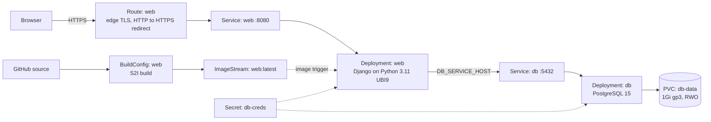

# OpenShift Customer PoC: Stateful Application Deployment

A proof of concept that deploys a two-tier customer workload (Django web app + PostgreSQL) on **Red Hat OpenShift Container Platform**, the way an after-sales engineer would during a customer trial. It covers the environment assessment, declarative deployment, persistent storage, secure exposure, verification, and a troubleshooting log written as support tickets.

**Platform:** Red Hat OpenShift 4 (Developer Sandbox, running on AWS) · **Tooling:** `oc` CLI 4.21, YAML manifests

## Architecture



| Component | OpenShift object | Purpose |
|---|---|---|
| Database | Deployment, Service, PVC, Secret | PostgreSQL 15 from Red Hat's certified image, persistent gp3 volume, credentials in a Secret |
| Image build | BuildConfig, ImageStream | Source-to-Image (S2I) build from GitHub with no Dockerfile; rebuilds when the Python base image is patched |
| Web app | Deployment, Service | Django app, rolled out automatically when a new image lands in the ImageStream |
| Exposure | Route | Public HTTPS URL; TLS terminated at the OpenShift router, HTTP redirected to HTTPS |

## Repository layout

```
manifests/
  db/
    00-secret.yaml.example   # template; the real 00-secret.yaml is git-ignored
    01-pvc.yaml
    02-deployment.yaml
    03-service.yaml
  web/
    01-imagestream.yaml
    02-buildconfig.yaml
    03-deployment.yaml
    04-service.yaml
    05-route.yaml
```

## Environment assessment

Collected before deployment with `oc describe quota`, `oc get limitrange` and `oc get storageclass`, as on any customer cluster.

| Item | Finding | Impact on the design |
|---|---|---|
| Compute quota (long-running pods) | 3 CPU / 30 GiB memory requests, 30 CPU / 30 GiB limits | Small requests (100m CPU, 256Mi) with explicit limits on every container |
| Compute quota (build pods) | 3 CPU / 14 GiB requests | S2I build capped at 1Gi memory |
| Storage quota | 10 PVCs, 80 GiB total | 1Gi volume for the database |
| Default LimitRange | `resource-limits` applied to the project | Explicit requests and limits set so defaults don't surprise us |
| Storage classes | `gp3` (default, AWS EBS, RWO), `gp2`, `efs-sc` (AWS EFS, RWX) | `gp3` for the database; `efs-sc` noted as the option for shared volumes |
| Volume binding | `WaitForFirstConsumer` | A new PVC stays `Pending` until a pod uses it. This is expected, not a fault |
| Builder images | `openshift/python` (3.11-ubi9 and others), `openshift/postgresql` (15-el9 and others) | Red Hat certified images used for both tiers |
| Security | `restricted-v2` SCC (random non-root UID) | Only images that run as non-root are used |

## Implementation plan

| Phase | Activity | Exit criteria |
|---|---|---|
| 1. Assess | Review quotas, limit ranges, storage classes and available images | Findings recorded (table above) |
| 2. Data tier | Apply `manifests/db/`: Secret, PVC, Deployment (Recreate strategy), Service | PVC `Bound`, pod `1/1 Running`, `psql` answers |
| 3. Build | Apply ImageStream and BuildConfig; S2I build from source | Build log ends with `Push successful` |
| 4. App tier | Apply web Deployment, Service and Route | Rollout complete, Route serves HTTPS |
| 5. Verify | Run the test plan below | All tests pass |
| 6. Hand over | Share the architecture, test report and troubleshooting log with the customer | Customer sign-off |

## Deploy it

```bash
oc login --token=<token> --server=<api-url>

# Data tier
cp manifests/db/00-secret.yaml.example manifests/db/00-secret.yaml   # set a real password
oc apply -f manifests/db/
oc rollout status deployment/db

# Build, then the app tier
oc apply -f manifests/web/01-imagestream.yaml -f manifests/web/02-buildconfig.yaml
oc logs -f bc/web
oc apply -f manifests/web/03-deployment.yaml -f manifests/web/04-service.yaml -f manifests/web/05-route.yaml
oc rollout status deployment/web
oc get route web
```

## Test report

| # | Test | Command / method | Expected | Result |
|---|---|---|---|---|
| 1 | Manifests valid against the cluster API | `oc apply -f manifests/ --dry-run=server` | All objects accepted | Pass |
| 2 | Persistent volume provisioned | `oc get pvc` | `db-data` Bound, 1Gi, gp3 | Pass |
| 3 | Database healthy | `oc get pods`; `oc rsh deployment/db psql -c "select version();"` | `1/1 Running`, version returned | Pass: PostgreSQL 15.8 |
| 4 | S2I build | `oc logs -f bc/web` | `Push successful` | Pass |
| 5 | App reachable over HTTPS | Open the Route URL | Welcome page loads | Pass |
| 6 | App connected to PostgreSQL | Welcome page database info and page-view counter | Counter increases on each refresh | Pass |

## Troubleshooting log

Recorded as support tickets, the format used with customers.

**TKT-001: Application unavailable the next morning**
- **Symptom:** `oc get deploy` showed `db 0/0`; no database pods.
- **Investigation:** No crash events, and the PVC was still `Bound`, so this was a scale-down rather than a failure.
- **Root cause:** The Developer Sandbox idles workloads to 0 replicas after about 12 hours.
- **Fix:** `oc scale deployment/db --replicas=1`. The volume and its data were unaffected.
- **Lesson:** Check replica counts before treating a missing pod as a crash.

**TKT-002: Sample application source missing**
- **Symptom:** The upstream sample repository's default branch (`master`) contained only a README.
- **Root cause:** The upstream project moved its code to version branches.
- **Fix:** Pinned the BuildConfig to `ref: 4.2.x`, which contains the full application.
- **Lesson:** Always pin build sources to a branch, tag or commit; never build from a moving default branch.

**TKT-003: Example Secret would overwrite the real one**
- **Symptom:** A server-side dry run of `oc apply -f manifests/db/` showed that both the real Secret and the example template would be applied, so the placeholder password would replace the real one.
- **Root cause:** `oc apply -f <dir>` applies every `.yaml` file in the directory.
- **Fix:** Renamed the template to `00-secret.yaml.example` (ignored by `oc`) and git-ignored the real `00-secret.yaml`.
- **Lesson:** Run `--dry-run=server` before applying, and keep credentials out of Git.

**TKT-004: `oc` commands failing with "provide credentials"**
- **Symptom:** `error: You must be logged in to the server (the server has asked for the client to provide credentials)`.
- **Root cause:** The `oc login` token had expired.
- **Fix:** Generated a new token from the web console (**Copy login command**) and logged in again.

## Design decisions

- **Recreate deployment strategy for the database.** The gp3 volume is ReadWriteOnce. A RollingUpdate would start the new pod while the old one still holds the volume, causing a `Multi-Attach` error. Recreate stops the old pod first.
- **Red Hat certified images.** Both tiers use images built to run under the `restricted-v2` SCC as a random non-root UID.
- **Credentials from a Secret.** The web app reads the database name, user and password through `secretKeyRef`; nothing is hard-coded in manifests.
- **Health probes and resource limits** on every container, so OpenShift can restart unhealthy pods and the project stays inside its quota.

## Production recommendations

This PoC uses an in-cluster database and a plain Secret because of Sandbox limits. For a production rollout I would recommend:

- **Database:** a managed or DBA-run PostgreSQL (for example Amazon RDS or the customer's on-prem cluster), reached through an `ExternalName` Service so the app manifests don't change. If the database must run in the cluster, use a PostgreSQL Operator (CloudNativePG or Crunchy) for replication, failover and backups.
- **Secrets:** HashiCorp Vault, AWS Secrets Manager or Azure Key Vault, synced by External Secrets Operator with workload identity. Etcd encryption enabled on the cluster.
- **Delivery:** GitOps with OpenShift GitOps (Argo CD) and CI with OpenShift Pipelines (Tekton); promotion to production through pull requests.
- **Resilience:** multiple web replicas with a HorizontalPodAutoscaler, PodDisruptionBudget and anti-affinity; NetworkPolicies allowing only router → web → db; scheduled database backups with a tested restore.

## Roadmap

- [ ] Kustomize base with dev and prod overlays
- [ ] NetworkPolicies, HPA, PodDisruptionBudget
- [ ] Tekton CI pipeline and Argo CD GitOps delivery
- [ ] Prometheus metrics, alert rules and a backup/restore drill
- [ ] Break-and-fix scenarios: SCC non-root failure, failing probes, OOMKilled, PVC issues
